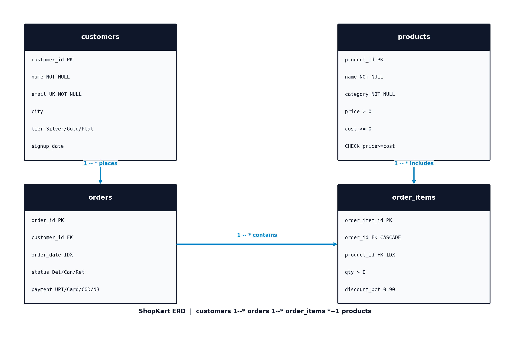

# ShopKart — E-commerce SQL Analytics

4-table normalized SQLite database simulating an Indian e-commerce store (ShopKart), with 4,550 rows + 15 interview-grade SQL queries covering cleaning, business insights, and advanced analytics.

 

## ERD



`customers 1──* orders 1──* order_items *──1 products`

Mermaid source: `ERD.mmd` · dbdiagram source: `erd_dbml.dbml`

## How to run (3 commands)

```bash
# 1. Create DB
sqlite3 shopkart.db ".read schema.sql"

# 2. Import data (or re-generate: python generate_data.py)
sqlite3 shopkart.db ".read import.sql"

# 3. Run queries
sqlite3 shopkart.db ".read queries/01_cleaning.sql"
sqlite3 shopkart.db ".read queries/02_business_insights.sql"
sqlite3 shopkart.db ".read queries/03_advanced.sql"
```

PowerShell note: use `".read file"` — `<` redirection does not work in PowerShell.

## Schema summary

| Table | Rows | Key columns |
|-------|------|-------------|
| customers | 500 | customer_id PK, email UNIQUE, tier Silver/Gold/Platinum, city (5.6% Unknown after clean) |
| products | 50 | product_id PK, category Electronics/Fashion/Grocery/Home/Beauty (10 each), CHECK price>=cost |
| orders | 1500 | order_id PK, customer_id FK, order_date IDX, status Delivered/Cancelled/Returned, payment_mode UPI/Card/COD/NetBanking |
| order_items | 2500 | order_item_id PK, order_id FK CASCADE, product_id FK IDX, qty>0, discount 0-90 |

Indexes: `idx_orders_date`, `idx_items_product` · View: `vw_monthly_revenue` · SQLite, PostgreSQL/MySQL compatible.

## Key insights (from this data)

1. **Revenue concentrated in Electronics:** Rs.1,10,82,627 total (1306 delivered orders, AOV Rs.8,486). Electronics Rs.81.6L (AOV Rs.20,974) vs Home Rs.12.3L, Fashion Rs.11.2L. Top product HP Laptop 15s Rs.38.4L.
2. **Repeat rate 80.3%** — 1306 delivered orders across ~500 customers. Top loyalist Karan Nair Rs.2.84L / 4 orders.
3. **COD fails 2.5x prepaid:** COD 23.6% (92/390) vs UPI 9.3%, Card 9.4%, NetBanking 8.3%. Status overall: Delivered 87.1%, Cancelled 8.6%, Returned 4.3%.
4. **City + trend:** Top known city Chennai Rs.8.39L, Agra Rs.7.71L (Unknown Rs.12.9L). Peak month 2026-06 Rs.12.97L, running total Rs.1.10Cr by Oct-26.

See `results/monthly_revenue.csv`, `category_revenue.csv`, `payment_fail.csv`.

## Queries

- `queries/01_cleaning.sql` — Q1-Q4: NULL cities (28→Unknown), dup emails (0), invalid rows (0), status split
- `queries/02_business_insights.sql` — Q5-Q11: monthly trend, top-5 products, category AOV, top-10 customers, repeat rate, fail by payment, city revenue
- `queries/03_advanced.sql` — Q12 RANK per category, Q13 running total SUM OVER, Q14 loyalists CTE+HAVING, Q15 view + EXPLAIN (SEARCH USING INDEX vs SCAN)

## Skills

Normalization, PK/FK, NOT NULL/UNIQUE/CHECK, SELECT/WHERE/JOIN/GROUP BY/HAVING/CASE, CTE/Subquery/VIEW, RANK/SUM OVER, Indexes + EXPLAIN QUERY PLAN

Future: Power BI dashboard on `vw_monthly_revenue`, RFM segmentation.

## Repo structure

```
sql-shopkart-analytics/
  README.md  schema.sql  import.sql  shopkart.db  ERD.png  ERD.mmd  erd_dbml.dbml
  generate_data.py  generate_erd.py
  data/customers.csv  products.csv  orders.csv  order_items.csv
  queries/01_cleaning.sql  02_business_insights.sql  03_advanced.sql
  results/monthly_revenue.csv  category_revenue.csv  payment_fail.csv
```
